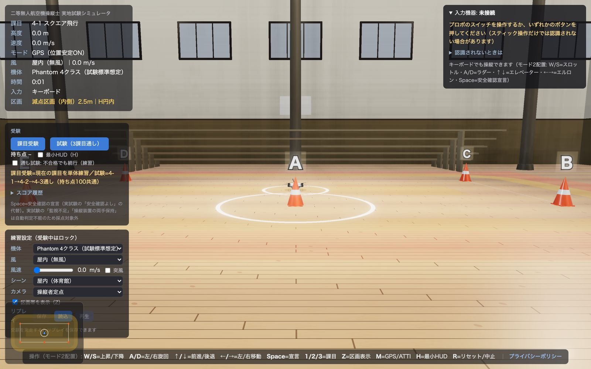

# ドローン実技シミュレータ（二等無人航空機操縦士）

二等無人航空機操縦士（回転翼・マルチローター・基本）の実地試験を、ブラウザの中の3D空間で練習できるシミュレータです。実物のプロポ（送信機）を USB で接続して操作できます。バックエンドのない静的な Web アプリです。

- デモ: https://drone-exam-sim.pages.dev/ （プロポがなくてもキーボードで操作できます）



## 主な機能

| 機能 | 内容 |
|---|---|
| 実技3課目 | 4-1 スクエア飛行／4-2 8の字飛行／4-3 異常事態における飛行。コースの寸法と制限時間は試験と同じです |
| プロポの接続 | USB ジョイスティックとして認識されるプロポを Gamepad API で接続。キャリブレーションの案内、モード1/2の切り替え、キーボードでの代替操作 |
| 採点 | 減点式（持ち点100・70点以上で合格）。区画からのはみ出し・危険な速度・指示違反などを自動で判定し、終わったら減点の内訳と軌跡の上面図を表示します |
| 機体の挙動 | GPS モード（位置を保つ）と ATTI モード（風で流される）の違い、定常風・突風・乱流の風モデル、機体3種 |
| 練習モード | 課目ごとの練習、区画と軌跡の表示、風・機体・カメラの変更、ミニマップ、リプレイ（JSON で保存・読み込み） |
| 試験モード | 3課目を通しで受験、区画は非表示、試験員の音声指示（字幕つき）、スコアの履歴 |

## 技術構成

TypeScript、three.js（WebGL）、Gamepad API、Vite、Vitest、Cloudflare Pages

## 設計で大事にしたこと

- **試験の基準は一次資料に合わせる。** コースの寸法と減点の基準は、実地試験の細則に合わせています。調査の記録と出典は [research/RESEARCH-2026-07-18.md](research/RESEARCH-2026-07-18.md) にあります。
- **よくある説明をうのみにしない。** 「二等の実技は全部 ATTI モード」という説明は細則と食い違うため、ATTI モードは 4-3 だけにしています。
- **仕様を先に文書にする。** AIに渡した仕様書が [CLAUDE-CODE-PROMPT.md](CLAUDE-CODE-PROMPT.md)、全体の設計が [DESIGN.md](DESIGN.md)、工程ごとのメモが `NOTES-M2.md`〜`NOTES-M5.md` です。

## 動かし方

```bash
npm install
npm run dev      # 開発サーバ（表示された URL を Chrome で開きます）
npm test         # テスト（Vitest）
npm run build    # 本番ビルド（dist/）
```

## キーボード操作（プロポがないとき）

| キー | 操作 |
|---|---|
| W / S | 上昇 / 下降 |
| A / D | 左右に旋回 |
| ↑ / ↓ | 前進 / 後退 |
| ← / → | 左 / 右に移動 |
| Space | 安全確認の宣言（離陸前・着陸前） |
| M | GPS ⇔ ATTI の切り替え（4-3 は ATTI 固定） |
| 1 / 2 / 3 | 課目の切り替え |

## テスト

Vitest で199件（2026年10月15日時点で、すべて成功しています）。

## 開発について

AIを使い、仕様書の作成から実装・テストまで1人で開発しました。

## このリポジトリについて

- 公開中のデモのソースコードを、閲覧用に公開しています。
- ライセンスは付けていません。著作権は作者に帰属します。
